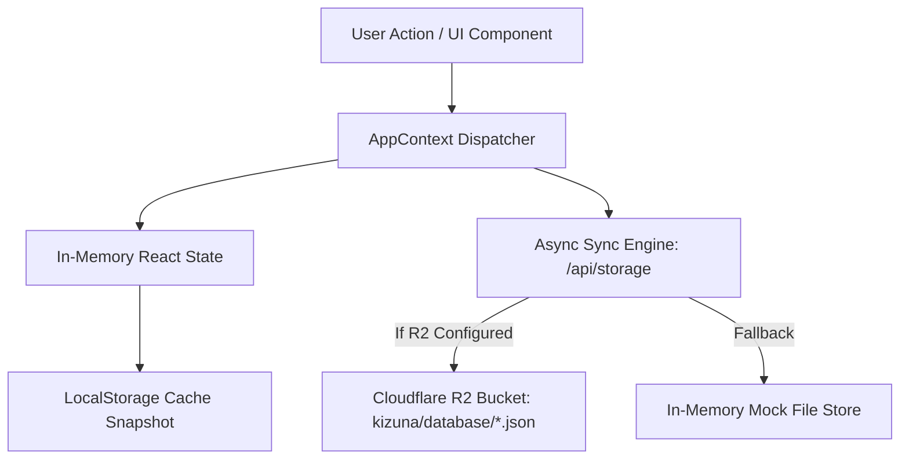

# RE-ASANA (Kizuna Project Management Tools)
## Comprehensive Agent & Developer Guide (`Agent.MD`)

---

## 1. Executive Summary & Architecture Overview

**RE-ASANA (Kizuna)** adalah implementasi klon presisi tinggi (*pixel-perfect reverse-engineered duplicate*) dari [Asana.com](https://asana.com) dengan tema gelap khas Asana (*charcoal dark theme*). Aplikasi ini dirancang menggunakan arsitektur modern Next.js 15 (App Router), React 19, TypeScript, dan Tailwind CSS, serta terintegrasi dengan **Cloudflare R2 Object Storage** untuk manajemen file dan snapshot basis data.

Aplikasi ini mencakup seluruh fungsionalitas inti Asana:
- Manajemen multi-workspace dan multi-user.
- Berbagai tampilan proyek dinamis: **List**, **Board (Kanban)**, **Calendar**, **Timeline (Gantt)**, **Dashboard (Analytics & Health)**, dan **Files**.
- Slide-over detail task (*Task Drawer*) dengan subtasks, lampiran file R2, komentar berutas, dan custom fields.
- Inbox notifikasi dan aktivitas proyek.
- Portfolios dan Goals level organisasi.
- Admin Console mandiri (`/admin`) untuk manajemen pengguna, lisensi, penagihan, resource, analitik, dan konfigurasi AI.
- Penyimpanan hybrid: LocalStorage + Cloudflare R2 snapshot sinkronisasi otomatis, dengan fallback lokal in-memory saat offline/kredensial R2 belum diisi.

---

## 2. Technology Stack & Dependencies

| Lapisan / Domain | Teknologi / Library | Catatan & Peran |
| :--- | :--- | :--- |
| **Framework** | **Next.js 15.1.7** | App Router (`src/app`), Server & Client Components, Route Handlers (`/api/storage`) |
| **UI Library** | **React 19.0.0** & **React DOM 19** | Menggunakan hooks modern (`useCallback`, `useMemo`, `useState`, `useEffect`) |
| **Bahasa** | **TypeScript 5.7.3** | Strict type definitions (`src/lib/types.ts`) untuk seluruh entitas data |
| **Styling** | **Tailwind CSS 3.4.17** | Custom charcoal dark theme, utility-first CSS |
| **Class Utilities**| `clsx` (2.1.1) & `tailwind-merge` (3.0.1) | Dynamic className merging |
| **Icons** | **Lucide React 0.475.0** | Set ikon antarmuka standar Asana |
| **Date Utility** | **date-fns 4.1.0** | Parsing tanggal, kalkulasi deadline, dan komparasi kalender |
| **Cloud Storage** | **@aws-sdk/client-s3 3.758.0** | Integrasi S3-compatible API ke Cloudflare R2 |
| **Presigned URLs**| **@aws-sdk/s3-request-presigner 3.758.0** | Generate secure upload/download URL R2 |
| **MCP Integration**| **engram-mcp** | Model Context Protocol server via `.mcp.json` |

---

## 3. Directory & File Structure

```text
RE-Asana/
├── .env.example                # Panduan konfigurasi environment variables (R2 & Google OAuth)
├── .gitignore                  # Git ignore rules
├── .mcp.json                   # Konfigurasi Model Context Protocol (Engram MCP)
├── Agent.MD                    # File panduan arsitektur & AI agent (Dokumen ini)
├── asana-session.har           # Session HAR capture autentik dari Asana untuk referensi reverse engineering
├── next.config.mjs             # Konfigurasi Next.js runtime & images
├── package.json                # Project dependencies dan npm scripts
├── postcss.config.mjs          # Konfigurasi PostCSS untuk Tailwind
├── README.md                   # Quickstart dan dokumentasi dasar
├── tailwind.config.js          # Konfigurasi theme, palette warna, dan extension
├── tsconfig.json               # Konfigurasi TypeScript paths (@/* -> src/*)
│
└── src/
    ├── app/                    # Next.js App Router (Halaman & Endpoint API)
    │   ├── layout.tsx          # RootLayout membungkus AppProvider & AppShell
    │   ├── globals.css         # Styling global, custom scrollbar, dan utility rules
    │   ├── page.tsx            # Halaman utama (Home dashboard dengan widget Asana)
    │   ├── login/page.tsx      # Halaman Login (Email/password & Google OAuth)
    │   ├── signup/page.tsx     # Halaman Registrasi pengguna baru
    │   ├── my-tasks/page.tsx   # Tampilan My Tasks pengguna aktif
    │   ├── inbox/page.tsx      # Tampilan Inbox notifikasi & mention
    │   ├── projects/page.tsx   # Katalog daftar semua project
    │   ├── project/[id]/page.tsx # Detail project: List, Board, Calendar, Timeline, Dashboard, Files
    │   ├── portfolios/page.tsx # Ringkasan portofolio proyek
    │   ├── portfolio/[id]/page.tsx # Detail portofolio spesifik & roll-up project
    │   ├── people/             # Directory anggota, tim, dan profil
    │   │   ├── page.tsx
    │   │   ├── team/page.tsx
    │   │   └── profile/page.tsx
    │   ├── admin/              # Standalone Admin Console Layout & Pages
    │   │   ├── layout.tsx      # Admin header, sidebar, dan container khusus
    │   │   ├── page.tsx        # Dashboard analitik & ringkasan admin
    │   │   ├── users/page.tsx  # Manajemen anggota, invite, suspend, dan license tier
    │   │   ├── billing/page.tsx # Paket lisensi, seat usage, dan tagihan
    │   │   ├── resources/page.tsx # Shared workspaces, project templates, resource locks
    │   │   ├── insights/page.tsx # Metrik produktivitas tim dan status proyek
    │   │   ├── globalsettings/page.tsx # Keamanan organisasi, autentikasi, domain
    │   │   └── ai-settings/page.tsx # Konfigurasi AI Asana Intelligence / Dash
    │   └── api/
    │       └── storage/
    │           └── route.ts    # API handler: upload, get, delete, dan snapshot DB Cloudflare R2
    │
    ├── components/             # Reusable UI Components
    │   ├── layout/
    │   │   ├── FarRail.tsx     # Bar navigasi paling kiri (Work, Agents, Strategy, Settings)
    │   │   ├── SideNav.tsx     # Sidebar navigasi expandable (Home, My Tasks, Inbox, Projects)
    │   │   ├── TopNav.tsx      # Top bar (Quick search, tombol Create (+), Profile avatar)
    │   │   ├── AppShell.tsx    # Wrapper layout utama dan route guard autentikasi
    │   │   └── CustomizeDrawer.tsx # Drawer kustomisasi tampilan project
    │   ├── tasks/
    │   │   ├── TaskRow.tsx     # Komponen baris task pada List View dengan inline edit
    │   │   ├── TaskList.tsx    # List View berkolom dengan grouping section
    │   │   ├── TaskBoard.tsx   # Kanban Board View kolom drag/move status
    │   │   ├── TaskCalendar.tsx # Kalender bulanan dengan marker task deadline
    │   │   ├── TaskTimeline.tsx # Timeline Gantt chart interaktif
    │   │   ├── TaskDashboard.tsx # Metrik, grafik kesehatan, dan task distribution
    │   │   ├── TaskFiles.tsx   # Tampilan galeri asset & attachment proyek
    │   │   ├── TaskDrawer.tsx  # Slide-over panel detail task (subtasks, attachment, log)
    │   │   ├── AddTaskSplitButton.tsx # Tombol add task / milestone / section
    │   │   ├── EditChartModal.tsx # Modal konfigurasi custom chart pada dashboard
    │   │   ├── DateRangePicker.tsx # Picker rentang tanggal deadline
    │   │   ├── FilterPopoverContent.tsx # Filter dinamis multi-kriteria
    │   │   ├── ListOptionsDrawer.tsx
    │   │   ├── BoardOptionsDrawer.tsx
    │   │   └── CalendarOptionsDrawer.tsx
    │   ├── modals/
    │   │   ├── CreateModal.tsx # Global modal (+ New Task, Project, Portfolio, Goal)
    │   │   ├── CreateGoalModal.tsx
    │   │   ├── CreateWorkspaceModal.tsx
    │   │   ├── InviteModal.tsx # Modal undang rekan kerja melalui email
    │   │   ├── SettingsModal.tsx # User settings modal dengan 9 sub-tab
    │   │   ├── EditProfileModal.tsx
    │   │   ├── EditFieldModal.tsx
    │   │   ├── AddFieldModal.tsx
    │   │   ├── ManagePrivacyModal.tsx
    │   │   └── ExploreProjectBar.tsx
    │   ├── dashboard/
    │   │   ├── DashboardWidgets.tsx # Widget Home (Notepad, Goals, Portfolios, Meetings, Mention)
    │   │   └── AddWidgetsDrawer.tsx # Drawer pemilihan widget kustom untuk Home
    │   ├── inbox/
    │   │   └── InboxView.tsx   # Panel inbox activity feed dan filter
    │   ├── admin/
    │   │   ├── AdminSidebar.tsx # Sidebar navigasi admin console
    │   │   ├── AdminModals.tsx  # Modal aksi admin
    │   │   └── UserSettingsModal.tsx
    │   ├── files/
    │   │   └── FileManager.tsx # Komponen explorer file
    │   └── common/
    │       └── EmojiPickerPopover.tsx
    │
    ├── context/
    │   └── AppContext.tsx      # State manager utama: CRUD, Auth, Sync R2/LocalStorage
    │
    └── lib/
        ├── types.ts            # Definisi Interface & Type data sistem
        ├── initialData.ts      # Mock dataset Asana (users, projects, tasks, goals)
        └── r2.ts               # Inisialisasi S3Client Cloudflare R2 dan helper upload/download
```

---

## 4. Design System & UI Specifications

UI aplikasi dibuat identik dengan Asana Dark Theme asli:

### Palet Warna Utama
- **Background Utama (`bg-[#1e1f21]`)**: Latar belakang aplikasi, kanvas utama, dan modal.
- **Far Left Rail (`bg-[#151617]`)**: Strip navigasi paling kiri yang sangat sempit.
- **Card / Surface (`bg-[#252628]` / `bg-[#2a2b2d]`)**: Latar kartu task, popover, dan panel drawer.
- **Border / Divider (`border-[#333538]` / `border-[#3b3d40]`)**: Garis pemisah elemen.
- **Accent Blue (`#4573d2`)**: Tombol aksi utama, link, indikator fokus, dan highlight aktif.
- **Accent Coral / Red (`#f06a6a`)**: Tombol "+ Create", status "Off track", dan badge prioritas tinggi.
- **Status Green (`#3ca76d`)**: Status "On track" dan task checklist complete.
- **Status Yellow / Orange (`#ec9a3c`)**: Status "At risk" dan peringatan.
- **Text Hierarchy**:
  - Primary: `#f5f4f3`
  - Secondary / Muted: `#a2a0a2` atau `#9ca3af`
  - Placeholder / Subtle: `#6a696a`

### Karakteristik Desain Asana
1. **Compact Dense Layout**: Padding dan margin proporsional (ukuran font 12px–14px untuk kepadatan data tinggi).
2. **Slide-over Drawers**: Detail task dan menu pengaturan meluncur dari sisi kanan layar (`fixed right-0 top-0 bottom-0 z-50`) tanpa merusak scroll posisi daftar.
3. **Pills & Badges**: Menggunakan border-radius `rounded-full` atau `rounded-md` dengan background kontras lembut untuk status, priority, dan assignee initials.

---

## 5. State Management & Data Persistence Architecture

Aplikasi menggunakan arsitektur state multi-tier yang terpusat di `src/context/AppContext.tsx`:



### Entitas Inti (`src/lib/types.ts`)
1. **`Task`**:
   - ID, nama, status penyelesaian (`completed`), section proyek (`To do`, `Doing`, `Done`, dsb.).
   - Section My Tasks (`Recently assigned`, `Do today`, `Do next week`, `Do later`).
   - Assignee, due date, priority (`Low`, `Medium`, `High`), status (`On track`, `At risk`, `Off track`).
   - Subtasks array (`Subtask[]`), lampiran (`Attachment[]`), komentar (`Comment[]`), custom fields.
2. **`Project`**:
   - ID, nama, owner, daftar anggota (`members`), sections array, portfolios relasi, dan workspace.
3. **`Portfolio`**:
   - Kumpulan project IDs, status agregat, progress rollup, owner, privacy, dan rentang tanggal.
4. **`Goal`**:
   - Target organisasi, time period, target progress (0–100%), dan penanggung jawab.
5. **`UserAccount`**:
   - Nama, email, role (`Member`, `Admin`, `Guest`), workspace aktif, inisial, dan avatar URL/warna.

### Mekanisme Sinkronisasi Database
- Saat inisialisasi (`useEffect`), `AppContext` mencoba melakukan `fetch('/api/storage?action=load_all_db')`.
- Jika data tersedia di Cloudflare R2, fungsi `mergeProjects`, `mergeTasks`, `mergePortfolios`, dan `mergeUsersByEmail` menggabungkan data lokal dengan data server secara deterministik tanpa menghapus data baru lokal.
- Setiap mutasi penting (tambah/edit task, update profil, tambah project) mendispatch permintaan debounced `POST /api/storage?action=save_db` dengan payload snapshot JSON.

---

## 6. Cloudflare R2 Storage & File Handling Pipeline

Backend penyimpanan objek berada di `src/app/api/storage/route.ts` dan `src/lib/r2.ts`.

### Endpoint API `/api/storage`:
1. **`POST /api/storage?action=save_db`**:
   - Menyimpan snapshot tabel JSON (`users.json`, `tasks.json`, `projects.json`, `portfolios.json`, `goals.json`) ke folder `kizuna/database/`.
2. **`POST /api/storage` (Multipart Form Data)**:
   - Mengunggah file attachment task. File di-upload ke `kizuna/{taskId}/{timestamp}-{sanitizedName}` di bucket R2.
   - Mengembalikan URL publik atau link proxy download.
3. **`GET /api/storage?action=load_all_db`**:
   - Mengambil seluruh file snapshot database dalam satu panggilan paralel.
4. **`GET /api/storage?key=<key>`**:
   - Melakukan streaming objek file langsung dari Cloudflare R2 dengan MIME type yang sesuai.
5. **`DELETE /api/storage?key=<key>`**:
   - Menghapus objek file dari bucket R2.

### Local Simulation Fallback
Jika environment variable R2 belum diisi, endpoint otomatis beralih ke `mockFileStore` (in-memory Base64 storage). Pengembang dapat menguji seluruh alur upload, download, dan snapshot database tanpa error koneksi.

---

## 7. Environment Variables & Setup Guide

Buat file `.env.local` di root proyek:

```bash
# Cloudflare R2 Object Storage
CLOUDFLARE_R2_ACCOUNT_ID="your_cloudflare_account_id"
CLOUDFLARE_R2_ACCESS_KEY_ID="your_r2_access_key_id"
CLOUDFLARE_R2_SECRET_ACCESS_KEY="your_r2_secret_access_key"
CLOUDFLARE_R2_BUCKET_NAME="kizuna-storage"
CLOUDFLARE_R2_PUBLIC_URL="https://pub-yourbucket.r2.dev" # Opsional jika public bucket diaktifkan

# Google OAuth Sign-In (Opsional untuk GIS Login)
NEXT_PUBLIC_GOOGLE_CLIENT_ID="your_google_client_id.apps.googleusercontent.com"

# MCP Server Configuration (Untuk AI Agent / Engram)
ENGRAM_API_KEY="your_engram_api_key" # Diperoleh dari https://ngrm.ai
```

---

## 8. Model Context Protocol (MCP) Setup

Proyek dilengkapi dengan konfigurasi `.mcp.json` untuk menjalankan `engram-mcp`:

```json
{
  "mcpServers": {
    "engram": {
      "command": "/Users/mac/.nvm/versions/node/v24.22.2/bin/npx",
      "args": ["-y", "engram-mcp"],
      "env": {
        "ENGRAM_API_KEY": "YOUR_API_KEY_HERE"
      }
    }
  }
}
```

> **Catatan Agent**: Path executable `npx` harus selalu menunjuk ke binary Node.js absolut dari environment workstation agar client GUI MCP dapat mengeksekusinya tanpa masalah resolusi `$PATH`.

---

## 9. Development & Deployment Commands

```bash
# Install dependencies
npm install

# Jalankan development server
npm run dev

# Jalankan linter ESLint
npm run lint

# Build untuk production
npm run build

# Menjalankan bundle production
npm run start
```

---

## 10. Rules & Conventions for AI Agents

Saat mengedit atau memperluas fitur di repositori ini, agen AI **wajib** mengikuti pedoman berikut:

1. **Jaga Presisi UI Asana**:
   - Gunakan palet warna Asana (`#1e1f21`, `#151617`, `#252628`, `#333538`, `#4573d2`, `#f06a6a`). Hindari mengubah latar ke warna putih atau abu-abu terang default.
2. **Hindari Direct Database Mutations di Component**:
   - Seluruh mutasi task, project, workspace, dan user **harus** melalui fungsi yang diekspos oleh `useApp()` (`src/context/AppContext.tsx`).
3. **Dukungan Dual Mode R2 & Local Fallback**:
   - Jangan pernah membuat fungsi upload/storage yang bergantung keras (*hard dependency*) pada R2 tanpa fallback. Pertahankan logika graceful fallback yang ada di `/api/storage`.
4. **Konsistensi Tipe Data**:
   - Selalu perbarui tipe data di `src/lib/types.ts` terlebih dahulu sebelum menambahkan properti baru ke model data `Task`, `Project`, atau `UserAccount`.
5. **Route Guard & Layout Standalone**:
   - Perhatikan bahwa rute `/admin/*` menggunakan layout mandiri tanpa `FarRail` dan `TopNav` reguler. Halaman auth (`/login`, `/signup`) tidak boleh menampilkan `AppShell`.
